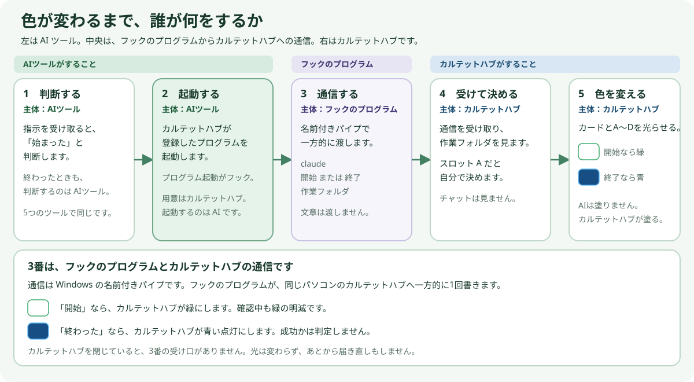
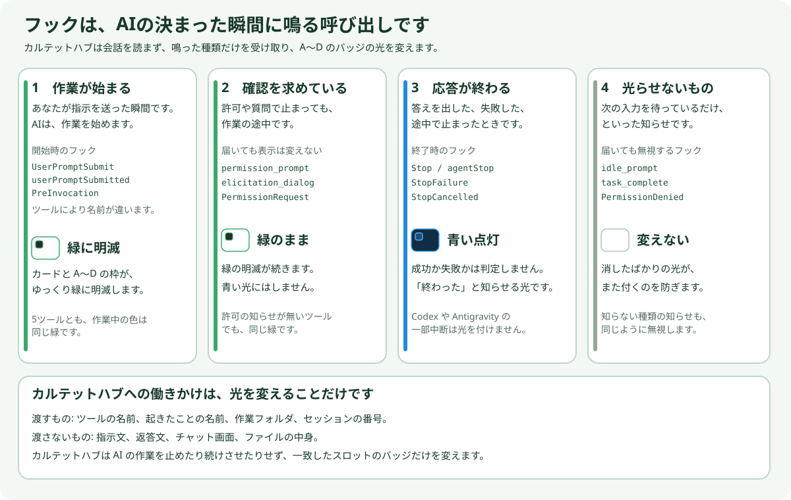
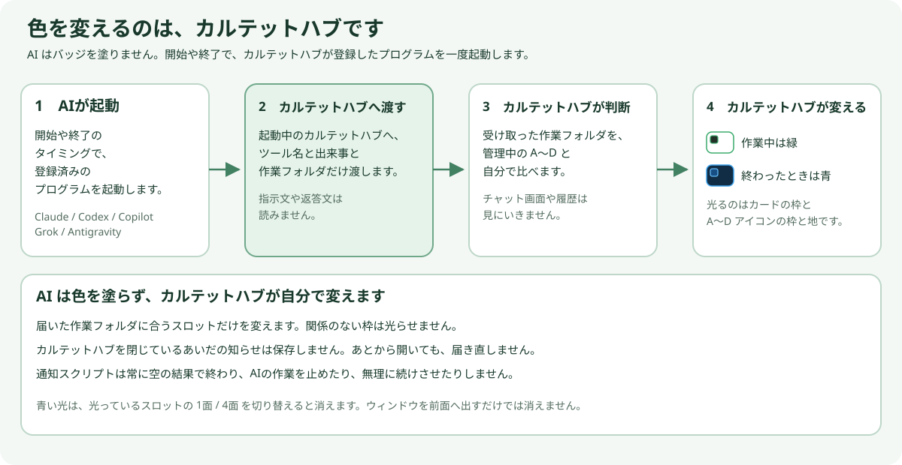
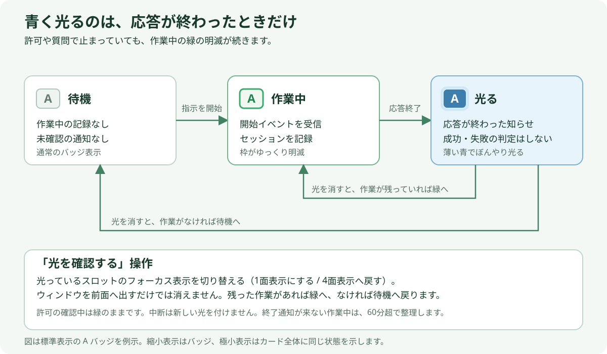
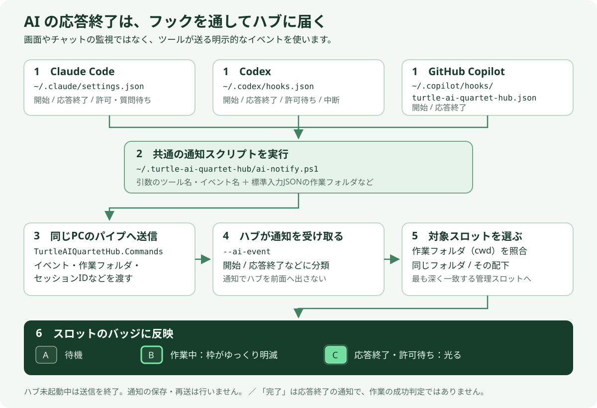

# AI の作業通知とフックのしくみ

[ドキュメント一覧へ戻る](../index.md)

確認日: 2026-11-13。フックガイドは、初めて読む人向けの説明から、今の実装で登録している内容までを順に書いています。実際のユーザーフォルダの中身は、文書の作成時には読んでいません。

カルテットハブは、Turtle AI Code Quartet Hub の名前です。

カルテットハブは、AI のチャット画面を見て状態を推測しません。色を変えるのは、開いているカルテットハブ自身です。AI はカードや A〜D アイコンを光らせません。開始や終了のタイミングで、登録済みのフックのプログラムを一度起動するだけです。

**青い点灯は、「応答が終わった」という意味だけです。** 許可や質問で止まっていても、作業の途中なので緑の明滅が続きます。変更が正しいことや、テストが成功したことは表しません。Claude Code、Codex、GitHub Copilot、Grok、Antigravity で、色や点滅の仕方は変えません。

## 色が変わるまで、何が動くか

スロット A のフォルダで、Claude Code に指示を送ったときの動きです。Codex、GitHub Copilot、Grok、Antigravity でも、動くものは同じです。



図の帯が主体です。左の緑は AI ツール、中央は AI が起動したフックのプログラム、右の青みは、カルテットハブです。3番は、フックのプログラムから開いているカルテットハブへの通信です。AI 自身が色を送るわけではありません。

図の 1 から 5 は、次の文章と同じ順です。

1. Claude Code が「作業が始まった」と判断します。
2. Claude Code は、カルテットハブが前もって登録しておいたフックのプログラムを起動します。プログラムの起動が、フックの発動です。
3. フックのプログラムは、同じパソコンの名前付きパイプで、開いているカルテットハブに「claude」「開始」「作業フォルダ」とだけ渡します。指示文や返答文は渡しません。
4. カルテットハブがそれを受け取り、フォルダがスロット A だと自分で判断します。
5. カルテットハブが、スロット A のカード枠と A アイコンの枠をゆっくり緑に明滅させ、カードの外側をぼんやり光らせます。

応答が終わったときも、動くのは 1 から 4 と同じです。Claude Code が「終わった」としてフックのプログラムを起動し、カルテットハブがボタンと IDE / CLI の中を除いてスロット A のカードと枠を青く染め、A アイコンを少し濃いめの青で点灯させます。

許可や質問で止まっているときも、プログラムが起動することがあります。カルテットハブは作業の途中だと判断して色を変えません。緑の明滅が続きます。

カルテットハブを閉じているあいだは、渡す相手がいないのでバッジは変わりません。閉じているあいだの知らせは保存されず、あとからカルテットハブを開いても届きません。

## 3番は、どういう通信か

3番は Windows の名前付きパイプです。インターネットや、ブラウザで開くような HTTP は使いません。同じパソコンの中だけで、フックのプログラムがカルテットハブへ一方的に1回書きます。カルテットハブからの返事は待ちません。

受け口の名前は `TurtleAIQuartetHub.Commands` です。カルテットハブを開いているあいだ、カルテットハブ自身が受け口を待ちます。フックのプログラムは、受け口へ接続して次のような1件を送ります。

```text
["--ai-event", "claude", "Stop", "C:\\work\\app", "セッション番号", ""]
```

入るのは、ツール名、出来事の名前、作業フォルダ、セッション番号、通知の種類だけです。

AI ツールとフックのプログラムのあいだは、名前付きパイプとは別です。AI がプログラムを起動し、フックの内容をプログラムの標準入力へ渡します。プログラムは AI へ `{}` を返して終了コード 0 で終わります。AI の作業は、プログラムの起動では止まりません。

カルテットハブを閉じていると、受け口が無いので接続を待たずに終わります。受け口があっても、接続の待ちは最大800ミリ秒です。送れなくても知らせは保存せず、AI へは同じく `{}` を返します。色を変えるのは、通信のあと、カルテットハブの中の処理です。

## フックとは

フックは、図の 2 番です。AI が「開始した」「終わった」と判断した瞬間に、あらかじめ登録したフックのプログラムを実行する仕組みです。ドアベルに近いものです。押されたことだけが伝わり、部屋の中の会話までは伝わりません。

カルテットハブが色を変えるのは、次の知らせが届いたときです。

- 作業が始まった。許可や質問で止まっているあいだも、緑の明滅のままです
- 応答が終わった。失敗や、Grok の一部の中断も、応答終了として扱います

届いても色を変えない知らせもあります。詳しくは次の表です。AI の作業を止めたり、無理に続けさせたりはしません。

## AI のどの状態で、フックが動くか



図の4枚は、左から「よく起きる順」です。確認を求めるのは、毎回あるわけではありません。

| あなたの見方 | 動くフックの例 | バッジ |
|---|---|---|
| 指示を送って、AI が作業を始めた | `UserPromptSubmit`、Copilot の `userPromptSubmitted`、Antigravity の `PreInvocation` | カードと A〜D の枠がゆっくり緑に明滅 |
| 許可や質問で止まっている | `permission_prompt`、`elicitation_dialog`、Codex の `PermissionRequest` | 緑の明滅のまま。変えない |
| 答えを出した、失敗した、途中で止まった | `Stop`、Copilot の `agentStop`、Grok の `StopFailure` / `StopCancelled` | カードと A〜D アイコンが青く点灯 |
| 次の入力を待っているだけ | `idle_prompt` など | 変えない |

許可や質問の確認は、作業が始まったあとの続きです。カルテットハブは、許可や質問の確認を特別な状態として見ません。青く光るのは、応答が終わったときだけです。

GitHub Copilot と Antigravity には、許可の確認を知らせるフックがありません。Claude Code、Codex、Grok も、許可や質問の確認中は緑の明滅のままです。応答が終わると、5つとも同じ青になります。

Codex で作業を中断したとき（`Interrupt`）や、Antigravity でユーザー自身がキャンセルしたとき（`Stop` / `USER_CANCELED`）は、新しい光を付けません。Grok の中断（`StopCancelled`）は、緑の明滅が残らないように、完了と同じ青にします。

`idle_prompt` は「次の入力を待てる状態」です。応答のあとだけでなく、失敗や中断のあとにも届くことがあります。これで光らせると、一度消した光が戻るため、カルテットハブは無視します。`task_complete` と `PermissionDenied`、知らない種類の知らせも無視します。

## フックの知らせは、カルテットハブへどう届くか



図の 1 から 4 は、前の図の 2 番から 5 番です。AI がフックのプログラムを起動し、カルテットハブが受け取って、カルテットハブが光を変えます。

1. AI ツールが、開始や終了のタイミングで、登録済みのフックのプログラムを起動します。許可の確認で起動しても、カルテットハブは色を変えません。
2. フックのプログラムが、ツールの名前、起きたことの名前、作業フォルダ、セッションの番号だけをまとめます。
3. 同じパソコンの中だけで、開いているカルテットハブへ渡します。カルテットハブを前面へ出すことはありません。外のサーバーへ送ることもありません。
4. カルテットハブが、作業フォルダの合う A〜D を自分で選び、選んだスロットのカードと A〜D アイコンを緑の明滅、または青の点灯に変えます。

カルテットハブが起動していないあいだの知らせは、保存しません。あとからカルテットハブを開いても、閉じているあいだの分は届きません。

作業フォルダが複数のスロットに合うときは、一番深く一致したフォルダのスロットを選びます。`C:\work\app` と `C:\work\application` のように、名前の前半だけが同じフォルダは、同じ場所とみなしません。SSH などのリモートの場所は、今は対象外です。

## 画面では、こう見えます



| 画面 | 意味 | 次にすること |
|---|---|---|
| いつものカード | 作業中の記録も、未確認の知らせもない | 指示を送ると、緑の明滅になる |
| 枠がゆっくり緑に明滅 | 作業中。許可や質問の確認中も含む | 応答が終わるのを待つ |
| 青く点灯してぼんやり光る | 応答が終わった | 内容を見て、光っているスロットのフォーカス表示を切り替える |

- 標準表示と縮小表示ではカード枠・外側の光背と A〜D アイコン、極小表示ではカードタイル全体に出ます。
- 光は、光っているスロットを1面表示にする、または4面表示へ戻すと消えます。ウィンドウを手前に出しただけでは消えません。
- 許可や質問の確認中は、緑の明滅のままです。青く光るのは応答が終わったときだけです。
- 終了の知らせが来ないまま残った作業中の記録は、始まってから60分を超えると片付けます。AI の処理を止める機能ではありません。

## 使うには

1. カルテットハブの右上の歯車から「設定」を開きます。
2. 「AI の作業通知」で、Claude Code、Codex、GitHub Copilot、Grok、Antigravity の状態を見ます。
3. 「フックを設定」を押します。設定フォルダがあるツールだけに、通知用のフックを登録します。フォルダが無いツールは、未インストールとして何も作りません。
4. Codex は、初回に CLI の `/hooks` で承認してください。Grok と Antigravity は、設定したあとに、開いているセッションやウィンドウを開き直してください。作業フォルダをまだ信頼していないときは `/hooks-trust` が必要です。ホームフォルダの直下は、信頼済みとして扱われます。
5. 各行の「フォルダ」で保存先を開けます。「設定を見る」では、設定ファイルの原文を、読み取り専用で確認・コピーできます。
6. カルテットハブで開いているローカルのフォルダに対して AI に指示し、バッジが変わるかを見ます。

「設定済み」は、登録と通知スクリプトがあることの確認です。知らせが実際に届いたかは、バッジか、歯車の「ログを表示」で確認します。

ファイルやフォルダがまだ無い行では、対応するボタンが押せません。ボタンにマウスを乗せると、理由が分かります。閲覧だけでは、ファイルもフォルダも作りません。大きい設定ファイルは、先頭の256Ki文字まで表示します。

カルテットハブの設定画面にある「仕組みを見る」でも、流れ、設定で変わること、表示の見方を、同じ設定枠の中で確認できます。**設定に戻る**、右上の **×**、**Escape** で設定へ戻ります。ガイドを読んだだけでは、設定ファイルは変わりません。

## 今の実装が登録しているもの

実装の説明では、カルテットハブが実際に書き込むファイルと、受け取って光らせる出来事を書きます。各製品が持っているフックのすべてではありません。



`~` は、Windows のユーザーホーム（通常は `%USERPROFILE%`）です。たとえば `~/.codex/hooks.json` は `%USERPROFILE%\.codex\hooks.json` です。

| 対象 | 保存先 | カルテットハブが行うこと |
|---|---|---|
| Claude Code | `~/.claude/settings.json` | 既存の設定に、通知用の項目を追加・解除 |
| Codex | `~/.codex/hooks.json` | 既存の設定に、通知用の項目を追加・解除 |
| GitHub Copilot | `~/.copilot/hooks/turtle-ai-quartet-hub.json` | カルテットハブ専用のファイルを書く。解除時に専用ファイルを削除 |
| Grok | `~/.grok/hooks/turtle-ai-quartet-hub.json` | カルテットハブ専用のファイルを追加・解除。ほかのフックファイルと `config.toml` は変更しない |
| Antigravity | `~/.gemini/config/hooks.json` | 名前付きフック `turtle-ai-quartet-hub`（`PreInvocation` / `Stop` の平坦な配列）を追加・解除。ほかの名前付きフックは残す |
| 共通の処理 | `~/.turtle-ai-quartet-hub/ai-notify.ps1` | 5ツールが共用するスクリプトを書く |

Claude Code と Codex は、ほかの設定や、自分で書いたフックを残します。書き換える直前の内容は、同じ場所の `ファイル名.turtle-hub-backup` に残します。設定し直すときも、書き換え直前の内容でバックアップを更新します。

Copilot の専用ファイルは、設定のたびに上書きし、解除で削除します。Copilot の専用ファイルにはバックアップがありません。ほかの名前のフックファイルには触れません。

Grok の専用ファイルだけを更新します。書き換える直前の内容は `.turtle-hub-backup` に残します。解除したあとカルテットハブの項目だけになると、空のファイルを残さず削除します。自分で足したキーが残っているときは、ファイルも残します。`~/.grok` フォルダが無いときは、何も作りません。

Antigravity は CLI（`agy`）・IDE・アプリの共通設定 `~/.gemini/config/hooks.json` を更新します。既存の別名のフック設定は残し、書き換える直前の内容は `.turtle-hub-backup` に残します。解除したあと空になると、ファイルを削除します。Antigravity 固有フォルダ（`~/.gemini/config`、`antigravity`、`antigravity-cli`、`antigravity-ide`）が無い場合（`@google/gemini-cli` の `~/.gemini/settings.json` のみ等）は、未インストールとして何もしません。

「フックを解除」は、カルテットハブが足した項目、Copilot の専用ファイル、空になった Grok の専用ファイルと Antigravity の `hooks.json` を取り除き、共通スクリプトの削除も試みます。バッジに残っている表示も消します。Codex の `config.toml` にある `notify` は、対象にしていません。

Grok は、Claude 用の `~/.claude/settings.json` も実行することがあります。Claude 向けのコマンドとして登録されているため、ツールチップが「Claude Code」になることがあります。光の色は同じです。カルテットハブは Grok の `config.toml` を書き換えないので、Claude 用フックの読み込みは止めません。

| ツール | 開始 → 緑 | 応答終了 → 青い点灯 | 許可・質問の確認 | 中断 |
|---|---|---|---|---|
| Claude Code | `UserPromptSubmit` | `Stop` | `permission_prompt` / `elicitation_dialog` は緑のまま | 登録なし |
| Codex | `UserPromptSubmit` | `Stop` | `PermissionRequest` は緑のまま | `Interrupt` は光を付けない |
| GitHub Copilot | `userPromptSubmitted` | `agentStop` | 知らせ自体がない。緑のまま | 登録なし |
| Grok | `UserPromptSubmit` | `Stop` / `StopFailure` / `StopCancelled` | `permission_prompt` / `elicitation_dialog` は緑のまま | `StopCancelled` も同じ青 |
| Antigravity | `PreInvocation` | `Stop` | 知らせ自体がない。緑のまま | `Stop`（`USER_CANCELED`）は光を付けない |

Grok と Antigravity の `Stop`、および開始フックは、フックの出力によって処理を止められます。通知スクリプトは空の `{}` を出して終了コード 0 で終わり、止めたり続けさせたりしません。Grok の `StopCancelled` は、次の指示の開始より遅れて届くことがあります。遅れて届いたときは、すでに始まった作業に対して、完了の光が付くことがあります。Antigravity の Windows フック実行系は `-File "..."` の引用符を拒否するため、空白がないパスは無引用の `/` 区切り、ユーザーホームに空白があるときは `hooks.json` 基準の相対パス `../../.turtle-ai-quartet-hub/ai-notify.ps1` で登録します。

## 届かないとき

| 確認すること | 見る場所 |
|---|---|
| カルテットハブが起動しているか | 止まっているあいだの知らせは、保存も再送もしません |
| 各ツールが「設定済み」か | 歯車 → AI の作業通知。エラーは状態にマウスを乗せると分かります |
| 設定と共通スクリプトがあるか | 各行の「設定を見る」と「フォルダ」。設定しただけでは、ツール側の読み込み完了は保証しません |
| 作業フォルダが、開いているスロットと合うか | 同じローカルフォルダか、作業フォルダの配下だけが対象です。控えだけのスロットや、ウィンドウの無いスロットへは届けません |
| SSH などのリモートではないか | `vscode-remote://...` のような場所は、今は照合しません |
| 対応する出来事が起きているか | カルテットハブは画面・チャット履歴・ログから状態を推測しません |
| カルテットハブが受け取った記録があるか | 歯車 →「ログを表示」で `AI event:` を探します。例: `AI event: codex Stop -> A:Done` |

`AI event:` は、知らせの意味が分かり、少なくとも1つのスロットに結びついたあとに出ます。記録が無いことだけでは、「フックが動かなかった」「送れなかった」「対象外だった」「フォルダが違った」のどれかは決まりません。

## 開発者向け：受け渡しと照合

スクリプトが送るのは、次の6要素の JSON 配列です。

```text
["--ai-event", tool, event, cwd, session, detail]
```

- `tool` と `event` は、カルテットハブが登録した起動コマンドの引数です。
- 標準入力の JSON から、`cwd`（無い場合は `workspacePaths` の先頭）、`session_id` / `sessionId` / `conversationId` / `conversation_id`、`notification_type` / `notificationType` / `terminationReason` を取り出します。これらも無いときの作業フォルダは、スクリプトの現在フォルダを使います。
- 送り先は、同じパソコンの名前付きパイプ `TurtleAIQuartetHub.Commands`（`\\.\pipe\TurtleAIQuartetHub.Commands`）です。カルテットハブが受け口を開き、スクリプトが1件書いて切断します。返事は読みません。先にパイプがあるかを確認し、接続の待ちは最大800ミリ秒です。送信に失敗しても AI の結果には影響させず、`{}` を出して終了コード 0 で終わります。スクリプトが終わったことと、カルテットハブへ届いたことは別です。
- カルテットハブは `tool:session` ごとに作業中の記録を持ちます。セッション番号が空のときは、ツール名をキーにします。
- 一番深く一致したワークスペースを選びます。同じ深さのパスを複数のスロットが持つときは、一致したスロットのすべてが対象です。Git Bash 形式の `/c/...` は、ローカルの Windows パスとして扱います。

### 実装を確認する場所

| ソース | 役割 |
|---|---|
| [AiNotifyHookInstaller.cs](../../src/TurtleAIQuartetHub.Panel/Services/AiNotifyHookInstaller.cs) | 保存先、出来事の登録、バックアップ、解除、共有スクリプト |
| [SingleInstanceCoordinator.cs](../../src/TurtleAIQuartetHub.Panel/Services/SingleInstanceCoordinator.cs) | カルテットハブ側の名前付きパイプ受信 |
| [App.xaml.cs](../../src/TurtleAIQuartetHub.Panel/App.xaml.cs) | 受信を画面の処理へ渡す。通知だけではカルテットハブを起動しない |
| [MainWindow.AiActivity.cs](../../src/TurtleAIQuartetHub.Panel/MainWindow.AiActivity.cs) | スロットの照合、表示の更新、ログ、光を消す処理 |
| [AiActivityTracker.cs](../../src/TurtleAIQuartetHub.Panel/Services/AiActivityTracker.cs) | 出来事の意味、セッションの管理、ローカルパスの照合 |
| [MainWindow.AiHookSettings.cs](../../src/TurtleAIQuartetHub.Panel/MainWindow.AiHookSettings.cs) | フォルダを開く、設定の読み取り専用プレビュー |
| [MainWindow.AiHookGuide.cs](../../src/TurtleAIQuartetHub.Panel/MainWindow.AiHookGuide.cs) | 設定枠の中でのガイド表示、戻る、スクロール位置の保持 |
| [AiHookGuideView.xaml](../../src/TurtleAIQuartetHub.Panel/Views/AiHookGuideView.xaml) | カルテットハブの設定画面にある3タブ。通知の流れは、AIツール / フックのプログラム / カルテットハブと、名前付きパイプの一方通行 |
| [MainWindow.xaml](../../src/TurtleAIQuartetHub.Panel/MainWindow.xaml) | 設定画面とバッジの表示 |
| [AiActivityTests.cs](../../src/TurtleAIQuartetHub.Panel.Tests/AiActivityTests.cs) / [AiHookLocationTests.cs](../../src/TurtleAIQuartetHub.Panel.Tests/AiHookLocationTests.cs) | 出来事、状態、照合、設定の保持、閲覧の回帰確認 |

図はリポジトリ内の SVG です。拡大するときは、[色が変わるまでの5つ](../assets/ai-notification-who-moves.svg)、[状態とフック](../assets/ai-notification-hooks-basics.svg)、[カルテットハブへの届き方](../assets/ai-notification-to-app.svg)、[バッジの変化](../assets/ai-notification-states.svg)、[実装の経路](../assets/ai-notification-flow.svg) を直接開いてください。
