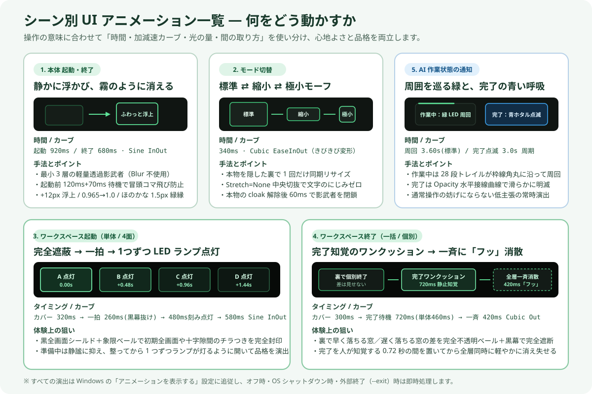
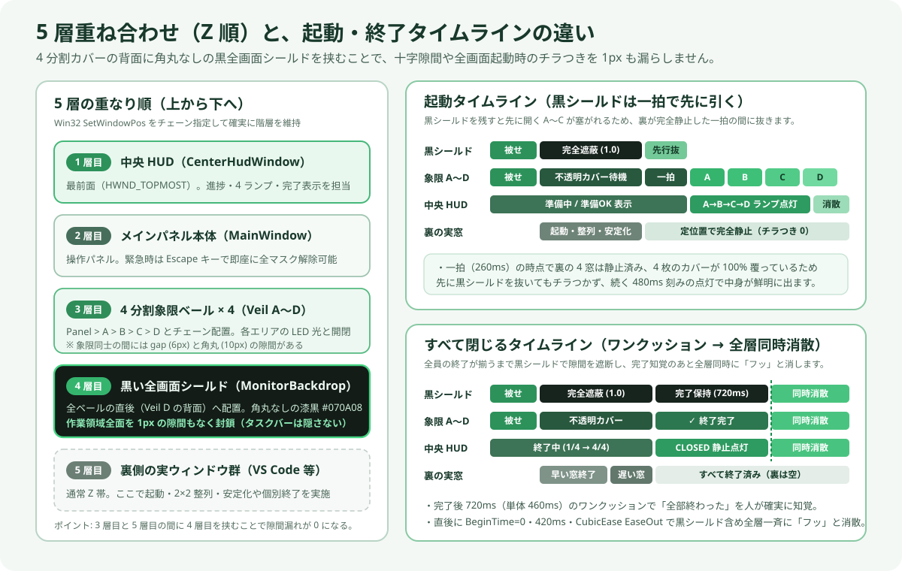
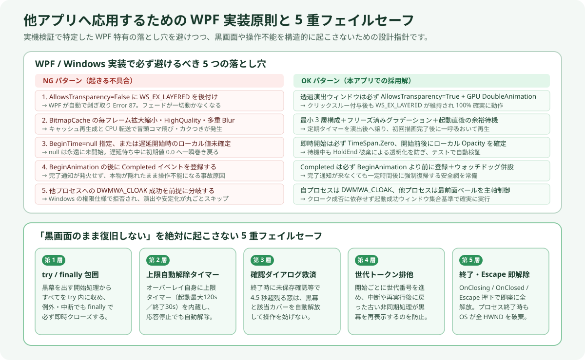

# UI アニメーション設計・実装ガイド

[ドキュメント一覧へ戻る](../index.md)

作成日: 2026-11-25。この資料は、Turtle AI Code Quartet Hub（カルテットハブ）で採用している UI アニメーションの設計思想・シーン別の使い分け・タイムライン・WPF 固有の注意点・フェイルセーフ構造をまとめたガイドです。別の Windows / WPF デスクトップアプリケーションへ同様の心地よい操作体験を応用する際の設計リファレンスとして利用できます。

---

## 1. 設計の基本方針

デスクトップツールにアニメーションを入れる目的は「派手に見せること」ではなく、次の 3 点を達成して**操作体験（UX）の安心感と品格を高めること**にあります。

1. **途中経過の乱雑さを隠す（ステージング）**: 外部ウィンドウの起動直後に起きる白画面・前回位置への瞬間復元・サイズ変更のガチャつきを、暗幕の裏で整えてから見せる。
2. **状態の変化を人間が知覚できる「間（ま）」を作る**: 速すぎると「何が起きたか分からない／世話しない」と感じ、遅すぎると待たされ感が出る。動作の意味に応じた加減速カーブと数十〜数百ミリ秒の「一拍」を設ける。
3. **絶対に画面を壊さない・操作不能にしない（フェイルセーフ）**: アニメーションの失敗・例外・途中中断が起きても、本物のウィンドウや黒画面マスクが残留しない構造を先に作る。

---

## 2. シーン別アニメーション一覧（いつ・何を・どう動かすか）

| シーン | 実装ファイル | 時間 | 加減速カーブ | 狙いと表現のポイント |
|---|---|---|---|---|
| **1. アプリ本体 起動・終了** | `MainWindow.StartupAnimation.cs` | 起動 `920ms` / 終了 `680ms` | `SineEase (EaseInOut)` | 最小 3 層の超軽量透過影武者で、`+12px → 0` の控えめな浮上・`0.965 → 1.0`・ほのかな 1.5px エメラルド縁により「静かに浮かび上がり、霧のように消える」。起動直後の `120ms + 70ms` 待機と定期タイマー後回しで冒頭コマ飛びを根絶。 |
| **2. 表示モード切替**（標準⇄縮小⇄極小） | `MainWindow.ModeTransition.cs` | `340ms` | `CubicEase (EaseInOut)` | 本物を `DWMWA_CLOAK` で隠した裏で 1 回だけ同期リサイズし、影武者の枠（`Rectangle` の `RadiusX/Y` で角丸 `8 ⇄ 58` まで GPU 補間）を小数点単位で四角⇄真円へ変形。画像は伸縮せず `Stretch=None` 中央配置で切り抜いてクロスフェードするため、文字が一切にじまない。 |
| **3. ワークスペース起動**（単体・4 面一括） | `MainWindow.LaunchPresentation.cs` `Services/LaunchStagingOverlay.cs` | カバー `320ms` → 一拍 `260ms`（単体 `120ms`）→ `480ms` 刻み点灯 → `580ms` 開放 | `SineEase (EaseInOut)` | 一括起動（複数同時）は 5 層遮蔽（黒全画面シールド＋象限ベール＋中央 HUD）、単体起動は象限ベール＋中央 HUD のみで他画面を暗転させずに裏で起動・配置・安定化を実施。全員静止後の一拍で黒シールドを先に抜き、A→B→C→D へ `480ms` 間隔で 1 つずつ LED ランプが灯るように開く。 |
| **4. ワークスペース終了**（すべて閉じる・個別） | `MainWindow.LaunchPresentation.cs` `Services/LaunchStagingOverlay.cs` | カバー `300ms` → 完了知覚 `720ms`（単体 `460ms`）→ 一斉消散 `420ms` | 消散のみ `CubicEase (EaseOut)` | 一括終了（複数同時）は 5 層遮蔽で裏の終了差を完全に隠し、単体の閉じる・クリアは象限ベール＋中央 HUD のみを表示。全員終了後に HUD の点滅を静止点灯へ変えて「すべて完了した」を人間が知覚する `720ms`（単体 `460ms`）のワンクッションを置いた直後、全層一斉に「フッ」と軽やかに消え失せる。 |
| **5. AI 作業状態の常時フィードバック** | `Services/AiCardOrbitGlow.cs` `Services/AiDoneFirefly.cs` | 作業中 `3.60s`（標準） 完了 `3.0s` 周期 | 緩加速トレイル / 水平接線曲線 | 作業中は 1px 枠線中心を 28 段グラデーションの緑 LED が一周、応答完了時は深い青でホタルのように呼吸点滅。日常操作の邪魔をしない低主張な光量に抑える。 |
| **6. アプリ本体 最小化**（タスクバーのボタンへ吸い込み） | `MainWindow.MinimizeAnimation.cs` `Services/TaskbarButtonLocator.cs` | `340ms` | `KeySpline (0.40, 0, 0.65, 0.80)`（横は `0.35, 0, 0.60, 0.85` で少し先行） | タスクバー上のこのアプリのボタンの位置を UI オートメーションで先読みし、起動・終了と同じ最小 3 層の影武者を重ねた直後に本物は即座に最小化する。影武者はボタンとほぼ同じ大きさ（約 7%）まで縮みながらボタンの中心へ吸い寄せられる。ゆっくり動き出して（ふわっ）途中で加速し（スーッ）、横幅を少し先に細らせて吸い口の形にする。飛びながら「くっきり → 軽くぼけ → 強くぼけ」の画像を入れ替えて輪郭ごと空気に溶かし、ボタンへ届く手前（道のりの約 9 割）で消えきる。ぼかしは縮小画像を CPU で一度だけぼかして作り、毎フレームの `BlurEffect` は使わない。本物を cloak で隠し続けないので、見えないまま残る事故が起きない。 |
| **7. アプリ本体 最小化からの復元**（タスクバーのボタンから広がる） | `MainWindow.RestoreAnimation.cs` | `340ms` | 最小化の `KeySpline` を時間について裏返した曲線（`1 − p(1 − t)`） | 復元の直前（`WM_WINDOWPOSCHANGING`、アプリ自身が戻すときは `WindowState = Normal` の直前）に本物を cloak で隠し、最小化をそっくり逆に再生する。ボタン付近から強くぼけたもやが集まるように現れ、くっきりへ戻りながら元の大きさへ広がって、元の位置にふわっと減速して収まる。最後のコマは本物と同じ見た目なので、cloak を外してから影武者を閉じる。復元されなかったときの後確認と期限付きの見張りで、隠れたまま残る事故を防ぐ。 |

上の図はシーン 1〜5 を示しています。シーン 6・7（最小化・復元）は図に含めていません。

### 加減速カーブ（イージング）選びの目安

他アプリへ応用する際は、動きの意図ごとに次の 3 種類を使い分けると自然な手触りになります。

- **`SineEase (EaseInOut)`（高貴・優雅な出現／開放）**: 動き始めも終わりも速度 0 から最も緩やかに繋がる S 字曲線。起動時の浮上や、ランプ点灯後に幕が「ふぁ〜っ…」と開く場面に最適。
- **`CubicEase (EaseInOut)`（きびきびした変形・移動）**: 中盤にしっかり速度が出るため、ウィンドウの縮小・拡大切替のように「素早く明確な反応」が欲しい操作に向く。
- **`CubicEase (EaseOut)`（軽やかな消散・フィニッシュ）**: ワンクッションで静止させた直後に、初速良くスッと抜けながら滑らかに消える。完了後に「フッ」と潔く片付く終了フィニッシュに最適。
- **`KeySpline` による「吸い込み」曲線（どこか 1 点へ吸い込まれる退場）**: `SplineDoubleKeyFrame` に CSS の cubic-bezier と同じ制御点を渡すと、組み込みのイージングより細かく緩急を決められる。最小化では `(0.40, 0, 0.65, 0.80)` を使い、ゆっくり動き出して途中で加速し、着地の直前だけ少し緩める。吸い込まれる見た目の要点は 3 つ。①移動と縮みを同じ曲線で進め、四隅がそろって 1 点（タスクバーのボタン）へ集まるようにする。②最後の大きさを着地点とほぼ同じまで本当に縮める（縮みが弱いと「四角いまま落ちる」ように見える）。③輪郭をくっきり残さない。あらかじめぼかした画像（外側へにじむ透明な余白付き）を後ろに重ね、飛びながら入れ替えて、着地の手前で消えきるようにする。

---

## 3. 5 層重ね合わせ構造と、起動・終了タイムラインの違い

複数のウィンドウを同時に扱う画面では、各エリアを覆うカバーだけを並べると、エリア間の隙間（`gap`）や角丸の四隅から裏のウィンドウ（初期全画面→リサイズや終了タイミング差）がチラついて見えてしまいます。

そこでカルテットハブでは、複数スロットを同時に扱う **一括起動・一括終了（すべて閉じる）時に限り、4 分割の象限ベールのすぐ背面に「角丸なしの漆黒・全画面シールド（`MonitorBackdropWindow`）」を挟む 5 層構造**を採用しています（単体での起動・閉じる・クリア時は他の開いているウィンドウまで暗転して混乱させないよう、黒全画面シールドは挟まず対象スロットの象限ベールと中央 HUD のみを表示します）。

### なぜ「起動」と「終了」で黒全画面シールドを消すタイミングを変えるのか

- **起動時は「一拍（260ms）の間に先に抜く」**:
  - 4 分割の象限ベールは A → B → C → D と 1 つずつ順番に開きます。もし背面の黒い全画面シールドを最後まで残してしまうと、先に開いた A・B・C が後ろの黒幕に塞がれて中身が見えなくなってしまいます。
  - 裏での起動・整列・配置安定化（`WaitForLaunchedWindowsToSettleAsync`）が終わった時点では、4 つの実ウィンドウはすでに定位置で 1 ピクセルも動かず静止しており、4 枚の象限ベールも 100% 不透明で覆っています。そのため、一拍の間に黒シールドだけを `220ms` でスッと引いてもチラつきは一切起きず、直後の 1 つずつランプ点灯で各画面が鮮やかに浮かび上がります。
- **すべて閉じる時は「ワンクッション後に全層同時に消す」**:
  - 終了時は裏側でアプリが消えていく順序を見せる必要がないため、全員の終了確認と完了知覚のワンクッション（一括 `720ms`／単体 `460ms`）の間ずっと黒シールドで隙間を遮断し続け、最後に **黒シールド・全象限ベール・中央 HUD へ同じ瞬間（`BeginTime = TimeSpan.Zero`）に `420ms` の `CubicEase EaseOut` を一斉投入** して 1 フレームのズレもなく「フッ」と消します。
- **Z 順のチェーン配置（重要な実装詳細）**:
  - Win32 の `SetWindowPos(hWnd, hWndInsertAfter, ...)` は指定ハンドルの「直後」へ配置します。4 枚の象限ベールをすべて同じ `panelHandle` 直後へ置くと順序が逆転し、最後に作ったベール 1 枚だけが黒シールドより前になって残り 3 枚が黒シールドの裏へ隠れる不具合が起きます。
  - 必ず `Panel > VeilA > VeilB > VeilC > VeilD > Backdrop` のように直前のハンドルへ**チェーン配置**することで、すべての象限ベールが確実に黒シールドの前面に並びます。

---

## 4. 他アプリへ応用するための WPF 実装原則と 5 重フェイルセーフ

実機検証で判明した WPF / Windows 固有の罠と、それを回避しつつ「黒画面が画面を覆ったまま復旧しない」事故を構造的にゼロにするフェイルセーフ設計を以下にまとめます。

### WPF で必ず守るべき 5 つの実装原則

1. **透過フェードするウィンドウは必ず `AllowsTransparency = true` にする**
   - `AllowsTransparency = false` の通常 WPF ウィンドウに対して Win32 `SetWindowLong(GWL_EXSTYLE, WS_EX_LAYERED)` を後から設定しても、WPF 内部フック（`WM_STYLECHANGING`）が `WS_EX_LAYERED` ビットを自動剥ぎ取りするため、`SetLayeredWindowAttributes` がエラー 87 で必ず失敗します。
   - 透過フェードが必要な演出ウィンドウ（影武者・象限ベール・黒全画面シールド・中央 HUD）はすべて `AllowsTransparency = true` とし、クリックスルー用の `SetWindowLong` は既存スタイルへ `WS_EX_TRANSPARENT | WS_EX_TOOLWINDOW | WS_EX_NOACTIVATE` を論理和で足すだけに留めます（`WS_EX_LAYERED` が維持されます）。
2. **透過ウィンドウを軽く保つ（引き算の最適化）**
   - `AllowsTransparency = true` 上で `BlurEffect` / `DropShadowEffect` を多数動かしたり、`BitmapCache` 付き要素へ毎フレーム `ScaleTransform` を掛けたり、`BitmapScalingMode.HighQuality` を付けたりすると、初回シェーダー初期化や毎フレームのキャッシュ再生成・CPU 転送でコマ飛びが発生します。
   - 影武者は最小 3 レイヤー（プレート＋キャプチャ画像＋1.5px 縁枠）に絞り、光漏れ表現はフリーズ済み（`Freeze()`）の `RadialGradientBrush` / `LinearGradientBrush` と多重ソフトリングだけで描画します。
   - 起動直後は `ContentRendered` 後に余裕待機（`120ms`＋影武者安定 `70ms`）を挟み、定期更新タイマーや重い非同期初期化は演出完了後へ譲ります。
3. **`Timeline.BeginTime` に `null` を渡さず、開始前後にローカル値を確定する**
   - WPF の仕様では `BeginTime = null` は「即時開始」ではなく **「永遠に開始しない」** を意味します。遅延なし開始は必ず `TimeSpan.Zero` を指定します。
   - `BeginTime > 0` の次アニメーションを `BeginAnimation` で開始すると、前の `FillBehavior.HoldEnd` 時計が破棄されて初期ローカル値（例: `Opacity = 0.0`）へ一時巻き戻ります。必ず `BeginAnimation` の直前にローカル値へ現在値（`1.0`）を書き戻し、`Completed` でも目標値をローカル値へ確定します。
4. **`Completed` イベントは必ず `BeginAnimation` より前に登録する**
   - WPF は `BeginAnimation` を呼んだ瞬間にアニメーション時計を生成し、その時点で登録済みの `Completed` だけを複製します。後からイベントを付けても永遠に呼ばれません。
5. **他プロセスへの `DWMWA_CLOAK` に依存しない**
   - Windows DWM のセキュリティ制限により、自プロセス（本体パネル）への `DWMWA_CLOAK` は成功しても、他プロセス（VS Code 等）への `DWMWA_CLOAK` は `E_ACCESSDENIED` で拒否される環境があります。他プロセス窓の演出は必ず最前面の不透明ベールと起動成功ウィンドウ一覧を主軸に制御します。

### 「黒画面のまま戻らない」を防ぐ 5 重フェイルセーフ

演出の見た目を一切損なわずに、以下の 5 重の安全装置を重ねています。

| 防御層 | 仕組み | 防げる事故 |
|---|---|---|
| **第 1 層: `try / finally` 完全包囲** | 黒幕を出す `BeginForLaunchAsync` / `BeginCoverForCloseAsync` 自体を `try` ブロックの内側に置き、`finally` で必ず `DismissImmediate()` を呼ぶ。 | 開始直後の設定保存・外部 API 呼び出し等での予期せぬ例外による黒画面残留。 |
| **第 2 層: 内蔵フェイルセーフ上限タイマー** | `LaunchStagingOverlay` 自身が上限タイマー（起動最大約 120 秒・終了 30 秒）を持ち、期限到達時は警告ログを残して全ベール・黒シールド・HUD を強制破棄する。 | 上位の外部プロセス起動／終了待機が万一ハング・無応答になった場合の黒画面居座り。 |
| **第 3 層: 4.5 秒確認ダイアログ自動救済** | 終了処理で 4.5 秒超閉じないウィンドウ（未保存変更の確認ダイアログ待ち等）が出た場合、対象ベールと該当モニタの黒全画面シールドを自動でフェード解放する（最大化全面カバー裏の別スロット停止時も全黒シールド・全面カバーを解放）。 | 未保存確認ダイアログが黒幕の裏に隠れてユーザーが操作できなくなる事故。 |
| **第 4 層: 世代トークン排他（`_sessionGeneration`）** | 開始・解除のたびに世代番号を進め、`await` 復帰後に世代が一致しない古い継続処理を即座に破棄する。 | 中断直後の再実行や連打による、古い非同期タスクからの黒幕再表示・二重アニメーション。 |
| **第 5 層: アプリ終了・`Escape` 緊急脱出・OS 保護** | `OnClosing`（終了確定時）・`OnClosed`・`Dispose`・パネルフォーカス時の `Escape` キーで即座に `DismissImmediate()` を実行。さらに万一プロセスが異常終了しても、すべての演出ウィンドウは同一プロセス所属のため OS が即座に全 HWND を破棄する。 | 途中終了・強制終了・緊急時の黒画面取り残し。 |

---

## 5. OS 設定・環境への配慮と自動検証

- **アクセシビリティ配慮**: すべてのアニメーションは `SystemParameters.ClientAreaAnimation`（Windows の「アニメーションを表示する」設定）を尊重し、オフの環境・OS シャットダウン時・配布ビルド前の外部終了（`--exit`）時はアニメーションを挟まず即座に完了します。
- **画面を出さない自動回帰テスト（`LaunchPresentationTests.cs`）**:
  - 透過必須ウィンドウの `AllowsTransparency == true` 保証とオフスクリーン描画サイズ計測（`Measure` / `Arrange` / `RenderSize`）
  - 非表示 1×1 の実 `HwndSource` 上で `BeginTime = TimeSpan.Zero` のフェードインが実際に完了すること、および続く `BeginTime > 0` 待機中に `Opacity = 1.0` が巻き戻らず保持されること
  - 1 つずつランプ点灯の時刻表間隔（`>= 450ms`）と終了完了ワンクッション時間（`>= 600ms`）の妥当性
  - 黒い全画面シールド適用ポリシーと、内蔵フェイルセーフタイマーによる自動解除動作

他アプリへ移植する際も、これら「時間定数の境界テスト」「`BeginTime` とローカル値保持の実時計テスト」「フェイルセーフ自動解除テスト」をセットで入れておくと、後日の改修による演出消失や黒画面残留のデグレを確実に防げます。
